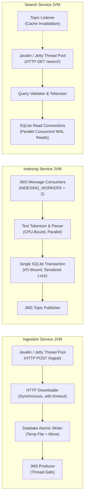

# 3. System Architecture and Design

## 3.1 Global System Overview

The Stage 2 Search Engine is architected as an event-driven collection of autonomous microservices executing within independent Java Virtual Machines on a single host. Communication is strictly partitioned between two distinct tiers:

1. **Public Front-End Tier:** Exposed exclusively by the Search Service over HTTP REST (port 7003), providing read-only endpoints consumed by human readers, client applications, and front-end user interfaces.
2. **Internal Choreography Tier:** Coordinated asynchronously through an embedded Apache ActiveMQ message broker (TCP port 61616). Services never initiate direct inter-service HTTP calls; instead, business workflows progress through discrete, immutable events published onto persistent message queues and topics.

```mermaid
flowchart TD
    subgraph Clients["External & Management Clients"]
        User["Web Browser / Search Client"]
        Op["Operator / Ingestion Script"]
    end

    subgraph BrokerSystem["Choreography Infrastructure (Port 61616)"]
        Broker["ActiveMQ Message Broker\n(KahaDB Persistent Store)"]
        Q_Down["Queue: books.downloaded\n(Persistent, Competing Consumers)"]
        T_Idx["Topic: books.indexed\n(Pub/Sub Broadcast)"]
        DLQ["ActiveMQ.DLQ\n(Dead Letter Queue)"]
        Broker --> Q_Down
        Broker --> T_Idx
        Broker --> DLQ
    end

    subgraph ServiceTier["Service Tier (Independent JVMs)"]
        Ingest["Ingestion Service\n(Port 7001)"]
        Index["Indexing Service\n(Port 7002, 7012...)"]
        Search1["Search Service - Replica 1\n(Port 7003)"]
        Search2["Search Service - Replica 2\n(Port 7013)"]
    end

    subgraph StorageTier["Physical Storage Layer (DATA_DIR)"]
        Datalake["Datalake Directory\n(yyyyMMdd/HH/*.txt)"]
        IngestDB["ingestion.db (SQLite WAL)\nOwner: Ingestion"]
        DatamartDB["datamart.db (SQLite WAL)\nOwner: Indexing"]
    end

    %% Client Calls
    User -->|GET /search\nGET /books/{id}| Search1
    User -.->|Client-side round-robin\n(no load balancer on one host)| Search2
    Op -->|POST /ingest/{id}| Ingest
    Op -->|POST /index/update/{id}\nPOST /index/rebuild| Index

    %% Ingestion flow
    Ingest -->|1. Atomic File Write| Datalake
    Ingest -->|2. Log Status| IngestDB
    Ingest -->|3. Publish Event| Q_Down

    %% Indexing flow
    Q_Down -->|4. Consume BookDownloaded| Index
    Index -->|5. Read Raw Text| Datalake
    Index -->|6. Atomic Transaction| DatamartDB
    Index -->|7. Publish Event| T_Idx
    Index -.->|Read-only lookup\nfor update and rebuild| IngestDB

    %% Search flow
    T_Idx -->|8. Invalidate Cache| Search1
    T_Idx -->|8. Invalidate Cache| Search2
    DatamartDB -->|Read-Only Queries| Search1
    DatamartDB -->|Read-Only Queries| Search2
```

---

## 3.2 Event Choreography vs. Central Orchestration

A pivotal decision in Stage 2 was adopting an **event-driven choreography** rather than a centralized orchestrator (such as a master workflow coordinator issuing HTTP calls).

| Architectural Quality | Central HTTP Orchestrator | Event Choreography (ActiveMQ) |
|---|---|---|
| **Coupling** | High: orchestrator must know network addresses and ports of all downstream services. | Low: services only know the broker URL (`tcp://localhost:61616`) and event schemas. |
| **Resilience to Crashes** | Fragile: if the orchestrator crashes mid-pipeline, state is lost unless backed by external consensus. | Robust: messages remain safely persisted in KahaDB until explicitly acknowledged after downstream commit. |
| **Backpressure Handling** | Difficult: requires rate-limiting algorithms, circuit breakers, and complex HTTP retry loops. | Natural: consumers pull messages at their own processing rate (`prefetch=1`); queues absorb sudden traffic bursts. |
| **Horizontal Scaling** | Requires service discovery and client-side load balancers for internal endpoints. | Trivial: spinning up multiple Indexing or Search JVMs automatically balances load via competing consumers. |

### Messaging Topology and Semantics

The message broker enforces two distinct messaging patterns tailored to workflow requirements:

1. **`books.downloaded` (Queue - Point-to-Point):**
   - **Delivery Mode:** `PERSISTENT` (backed by KahaDB write-ahead logs on disk).
   - **Distribution:** Competing Consumers pattern. Worker threads across one or more Indexing processes compete for messages.
   - **Prefetch Policy:** Set to `prefetch=1`. This prevents a single fast thread or worker from hoarding batches of books while other workers sit idle, ensuring optimal load distribution across multi-threaded workers.
   - **Acknowledgement Mode:** Transacted JMS session (`SESSION_TRANSACTED`), one per worker thread. The consumer commits the session, which acknowledges the message and releases its `BookIndexed` event, **only after** the SQLite transaction with the book's metadata and postings has committed. If indexing fails, the session is rolled back; if the process crashes, the broker detects the lost connection. In both cases the message is redelivered to an available worker.
   - **Dead Letter Strategy:** The broker's `RedeliveryPlugin` redelivers a failed message up to 5 times with a fixed delay of 2 s (no exponential backoff); client-side redelivery is disabled so that only the broker counts attempts. Poison messages (unreadable JSON, invalid events or missing files) then go to `ActiveMQ.DLQ` without halting the ingestion or indexing pipelines.

2. **`books.indexed` (Topic - Publish/Subscribe):**
   - **Delivery Mode:** Broadcast to all active subscribers.
   - **Distribution:** Fan-out to every running Search Service replica.
   - **Purpose:** Informs Search replicas that a new book has entered the datamart, prompting them to invalidate their in-memory filter caches (distinct languages and publication years). Searches themselves read committed SQLite WAL snapshots directly from disk, so they never depend on the events. The subscription is not durable: while a replica is disconnected from the broker, or before it has subscribed after a restart, its cache is disabled and every request reads the datamart. On reconnection the cache is emptied and enabled again, so missed events can never leave stale filter values.

---

## 3.3 Storage Isolation and the Single-Writer Principle

Data storage is partitioned into separate directories under `DATA_DIR`, one per owner:

```
DATA_DIR/
├── broker/                  (Owned by the ActiveMQ broker)
│   └── kahadb/              (KahaDB journal files and indexes: db-1.log, db.data, ...)
├── datalake/                (Owned exclusively by Ingestion Service)
│   ├── ingestion.db         (SQLite database: book_id, status, paths, timestamp)
│   ├── ingestion.db-wal
│   ├── ingestion.db-shm
│   └── yyyyMMdd/
│       └── HH/
│           ├── 1342.header.txt
│           └── 1342.body.txt
└── datamarts/               (Owned exclusively by Indexing Service)
    ├── datamart.db          (SQLite database: books, postings, index_meta)
    ├── datamart.db-wal
    └── datamart.db-shm
```

### The Single-Writer Principle
Concurrent file modification across autonomous processes is a notorious source of silent data corruption. Stage 2 resolves this by enforcing that **every file and database has exactly one designated writer process**:
- **Ingestion Service:** Only writer for the datalake text files and `ingestion.db`.
- **Indexing Service:** Only writer for `datamart.db`. It opens `ingestion.db` strictly read-only (a read-only SQLite connection from `common.Sqlite.openReadOnly`), only to locate the files of available books for the administrative operations `POST /index/update/{book_id}` and `POST /index/rebuild`.
- **Search Service:** Strictly read-only consumer of `datamart.db`. It never writes to disk.
- **ActiveMQ Broker:** Only writer for the `broker/` directory.

### SQLite WAL Mode Concurrency
Both `ingestion.db` and `datamart.db` are configured with Write-Ahead Logging (`PRAGMA journal_mode=WAL`), `PRAGMA synchronous=NORMAL`, and `PRAGMA busy_timeout=5000`. WAL mode provides essential concurrency guarantees:
- **Readers never block writers**, and **writers never block readers**.
- Multiple Search service replicas can query `datamart.db` concurrently without experiencing lock contention while Indexing commits new book postings in the background.
- Concurrent SQLite writers are serialised via internal file locks. As established in the official benchmarks (Section 7), scaling Indexing worker threads beyond 2 workers saturates the single-writer lock; thus, true parallelism occurs during in-memory text tokenization, while database commits queue safely.

---

## 3.4 Concurrency and Threading Architecture

Every service runs in its own JVM process with a dedicated threading model tailored to its operational workload:



1. **Ingestion Service:**
   - Jetty HTTP server manages incoming client ingestion requests across an adaptive thread pool.
   - Text downloading and file writing are stateless and execute concurrently across threads.
   - Each thread obtains its own connection to `ingestion.db`, relying on SQLite WAL mode to coordinate the brief record inserts.
2. **Indexing Service:**
   - Spawns `INDEXING_WORKERS` concurrent JMS consumer sessions (default: 2 threads).
   - Each worker retrieves one `BookDownloaded` event (`prefetch=1`), independently reads the text files from the datalake, and tokenizes terms in memory.
   - Each book is stored in one SQLite transaction (delete the old postings, insert the new ones, upsert the book and `index_meta`), which waits up to `busy_timeout` if another worker is holding the write lock.
3. **Search Service:**
   - Handles read traffic using Jetty's worker threads.
   - Because queries only issue `SELECT` statements, SQLite WAL mode serves concurrent readers simultaneously through shared memory (`.shm`). Below saturation a search takes about 1–2.5 ms at the median (section 7.x).
